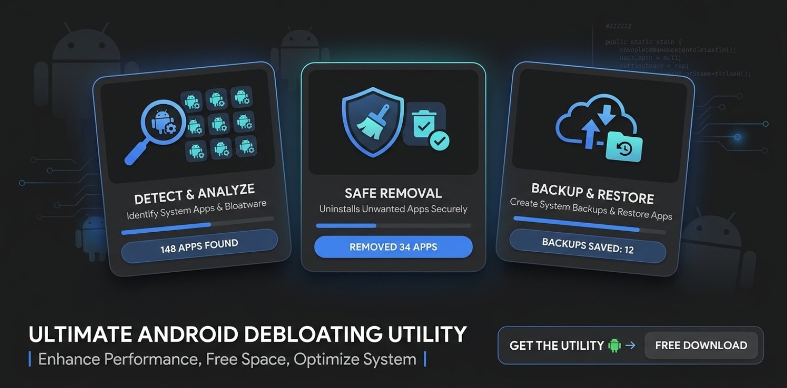

<p align="center">
  
</p>

# Bloatware Exorcism — Android Debloater for MIUI & HyperOS

**Bloatware Exorcism** is an open-source, offline **Android debloater and system app manager** for Xiaomi MIUI and HyperOS, using **KernelSU root access**. Inspect installed packages, disable or uninstall selected bloatware for the current Android user, and restore recorded package changes through a **Material Design 3 (Material You)** interface.

Designed for manual package review, package-state backups and reversible debloating workflows. No INTERNET permission, ads or analytics. Compatibility and recovery limits are documented below.

**Em português:** gerenciador de bloatware para Android, com foco em Xiaomi MIUI e HyperOS e acesso root via KernelSU. Permite revisar, desativar ou desinstalar aplicativos de sistema para o usuário atual, salvar estados dos pacotes e restaurar alterações registradas. Funciona offline e usa uma interface Material You.

[Download APK](https://github.com/Llkk77/BloatwareExorcism-Android-Debloater/releases) · [Features](#features) · [Installation](#requirements-and-installation) · [Build from source](#build-from-source) · [Limitations](#validation-and-recovery-limits)

## Downloads

- [APK and version releases](https://github.com/Llkk77/BloatwareExorcism-Android-Debloater/releases)
- [Browse the Android source](app/src/main)
- [Source ZIP downloads](https://github.com/Llkk77/BloatwareExorcism-Android-Debloater/archive/refs/heads/main.zip)
- [v0.3.1 release notes](RELEASE_NOTES.md)
- [Verification and limitations](VERIFICATION.md)

The complete source is now available as a normal GitHub file tree: [Android app](app), [root policy](app/src/main/java/dev/bloatware/exorcism/Policy.java), [rescue module](rescue-module), [tests](tests) and [third-party notices](third-party). Clone the repository and open its root in Android Studio. Historical release ZIPs remain attached to their original releases. Private signing keys are excluded.

## Features

Android bloatware removal, system package inspection, backup and restoration are organized into five tools:

| Feature | Function |
|---|---|
| Exorcise | Disable or remove manually selected classified system packages for the current Android user |
| Detect Demons | Inspect installed packages and declared components |
| Holy Backup | Save, export, import and compare package-state snapshots |
| Resurrection | Restore recorded package changes |
| Deep Exorcism | Review advanced packages and audit native services; optional experimental KernelSU rescue module |

## Version 0.3.1

- Official Material Web components bundled offline, with Roboto typography and tonal surfaces.
- Dark dynamic colors on compatible Android devices; Exorcism blue fallback.
- Ripple feedback, smooth transitions, reduced-motion handling and adaptive navigation.
- One-tap ordinary selected-package actions with automatic backup; advanced packages retain review.
- No INTERNET permission, ads or analytics.

<p align="center">
  
</p>

*Promotional illustration, not an app screenshot or measured results. Holy Backup saves package states, not full system backups. The depicted counts are illustrative; performance and storage gains are not verified.*

## Requirements and installation

Android 10 or later. Initial focus: MIUI/HyperOS Global and China ROMs, Android 16 and KernelSU.

1. Download and install the test APK from Releases.
2. Grant root access through KernelSU.
3. Export a Holy Backup before changing packages.
4. Review the selection, apply the desired action and check device functions afterward.

The certificate matches v0.2.2. This is a development-signed test build.

## Build from source

Requirements: JDK 17, Android SDK Platform 36 and Build Tools 36.0.0. Gradle 8.11.1 and Android Gradle Plugin 8.10.1 are configured in the project.

```sh
git clone https://github.com/Llkk77/BloatwareExorcism-Android-Debloater.git
cd BloatwareExorcism-Android-Debloater
sh gradlew assembleDebug lintDebug
```

Material dependencies and the font are already bundled in the APK assets. Node is only needed to rebuild the UI dependency bundle; see the included README and `docs/MATERIAL3.md`.

## Validation and recovery limits

Compilation, lint, policy/fixture tests and controlled browser UI/accessibility checks passed.

**Physical-device testing:** Llkk77 reports that all tests performed on a **POCO M6 PRO** completed successfully. This updates the earlier build-time report, which did not include physical-device or emulator testing.

**Testes em aparelho físico:** Llkk77 realizou testes no **POCO M6 PRO** e informou que todos os testes executados foram concluídos com êxito.

These results apply to the tested device and configuration. Android/ROM version, KernelSU version and individual test logs have not yet been documented here. Compatibility with other devices, firmware configurations and recovery scenarios is not established by this report. No measured performance gain is claimed.

Holy Backup records package states, not personal app data or firmware images. Root removal uses the current-user package operation and retains original system files; it is not partition cleanup. Core/protected packages remain blocked. The rescue module is experimental and cannot guarantee recovery.

## Security, permissions and verifiable builds

This app runs privileged package commands. Review the source and [SECURITY.md](SECURITY.md) before granting root. Holy Backup is a package-state snapshot, not a full device backup; the optional rescue module cannot guarantee boot recovery.

- The only declared Android permission is `QUERY_ALL_PACKAGES`, used for package discovery. KernelSU authorization is requested separately through `su`. File import/export uses Android’s document picker. No INTERNET permission is declared.
- [Android CI](https://github.com/Llkk77/BloatwareExorcism-Android-Debloater/actions/workflows/android.yml) builds the source and runs policy, fixture, simulated rescue and lint checks. Read the actual run status; CI does not establish firmware safety.
- [Build and release guide](docs/BUILD_AND_RELEASE.md): APK SHA-256, certificate checks, a dedicated release key and signing migration. CI debug APKs use a temporary test certificate; unsigned release artifacts require signing.
- [Root review notes](docs/ROOT_REVIEW.md): observations and unresolved review areas. An independent audit and byte-for-byte reproducibility have not been completed.
- [Device/Android Studio checklist](docs/DEVICE_TESTING.md): broader testing and real screenshots are pending. Existing banners below are promotional artwork.

### Published test APK identity

The existing v0.3.1 development-signed APK has SHA-256:

```text
004d83c55742676bd65e226e939297d23da1d40838c2fd61a08d13cc07253027
```

Compare it with `SHA256SUMS.txt` in [the same release](https://github.com/Llkk77/BloatwareExorcism-Android-Debloater/releases/tag/v0.3.1). This identifies that file; it does not certify security. [VirusTotal report for this exact APK](https://www.virustotal.com/gui/file/004d83c55742676bd65e226e939297d23da1d40838c2fd61a08d13cc07253027?nocache=1): **0/66 detections** in the analysis dated **2026-10-22**. This is a malware-scanner result, not a security certification or validation of root operations, firmware safety, or boot recovery. Results may change; check the live report.

## FAQ

**Does it require root?** Package changes require root through KernelSU. A normal Android Studio emulator without equivalent root cannot validate those operations.

**Does removal delete the system APK?** No. Removal targets the current Android user and retains original system files. Storage or performance improvements are not guaranteed.

**Can I recover everything with Holy Backup?** No. It records package states, not private app data or firmware images. Export it before uninstalling or changing signing identities.

**Is every Xiaomi or HyperOS build validated?** No. Llkk77 reported successful tests on a POCO M6 PRO; broader review and Android Studio testing are planned. Device/ROM/version-specific evidence should accompany future reports.

**Are these real app screenshots?** The banners are promotional illustrations. Real device captures and GIFs will be added after the maintainer’s test campaign; none are fabricated here.

**Where can I contribute?** Use [Issues](https://github.com/Llkk77/BloatwareExorcism-Android-Debloater/issues) for bugs and Discussions for questions. See [CONTRIBUTING.md](CONTRIBUTING.md). No F-Droid/IzzyOnDroid acceptance or external security endorsement is claimed.

## License

MIT. Material, Lit and Roboto notices are included in the source archive.

## Contributions

- Llkk77
- ChatGPT

ChatGPT assisted with code and documentation. Llkk77 reports the device tests; human source review and broader Android Studio testing are in progress. No independent review is claimed.

<p align="center">
  
</p>
